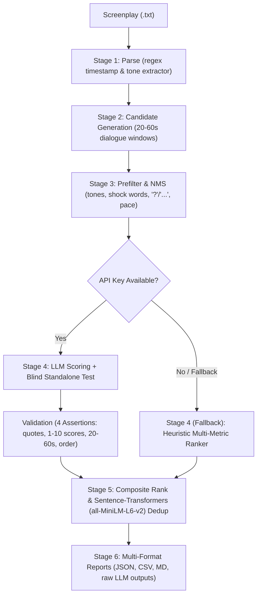

# 🎬 Microdrama Promo Clip Finder

A high-performance pipeline and interactive Streamlit web application that ingests timestamped microdrama screenplays (`.txt`) and discovers the best **20–60 second promo clips** — featuring a gripping hook within the first 3 seconds, high emotional intensity, a cliffhanger ending, standalone narrative understandability, and semantic deduplication.

---

## 🌟 Key Features

- **Interactive Streamlit Web UI**: Upload screenplay `.txt` files (single or batch), click **Run Promo Finder**, inspect an interactive ranked table with score breakdowns and dialogue cards, and download **CSV**, **JSON**, and **Markdown** reports.
- **Dual Engine Execution**:
  - **Full LLM Mode**: Powered by LLM evaluation (OpenRouter Nemotron / Gemini) with strict Pydantic JSON schemas, validation assertions, and a **Blind Standalone Test** (where the model only sees clip dialogue without story background to assess viewer comprehension).
  - **Zero-Cost Fallback Mode**: When no API key is configured (or when explicitly toggled), the system automatically ranks clips using a 4-factor heuristic prefilter (tone tags, '?'/'...' cliffhanger punctuation, shock drama keywords, dialogue line pace) plus **Sentence-Transformers (`all-MiniLM-L6-v2`)** for local semantic near-duplicate pruning.
- **Strict Code vs. LLM Boundary**: Code handles 100% of the timestamp math, sliding window generation, duration validation, and deduplication. The LLM never sees or outputs timestamps.
- **Persistent Disk Caching**: LLM prompts are cached locally on disk in `cache/` keyed by `sha256(provider + model + temperature + prompt)`. Identical prompts return immediately with 0 token spend.

---

## 📁 Project Structure

```
├── app.py                      # Streamlit Web UI & CLI dual-mode orchestrator
├── config.yaml                 # Configurable weights, window constraints, model settings
├── requirements.txt            # Python dependencies (Streamlit, PyTorch/SentenceTransformers, Pydantic, etc.)
├── .env.example                # Environment variable template
├── .env                        # Local secrets / API keys (gitignored)
├── cache/                      # LLM response disk cache (gitignored)
├── outputs/                    # Output artifacts
│   ├── promos.json             # Structured JSON of selected promo clips
│   ├── promos.csv              # CSV table of selected promos with all metrics
│   ├── report.md               # Formatted markdown summary report
│   └── raw/                    # Unedited raw LLM JSON responses per clip
└── src/
    ├── __init__.py
    ├── parse.py                # Stage 1: Parse screenplay dialogue, tone tags, and timestamps
    ├── candidates.py           # Stage 2: Enumerate 20–60s dialogue-bounded candidate windows
    ├── prefilter.py            # Stage 3: Heuristic scoring (tones, '?'/'...', shock words, pace) + NMS
    ├── llm.py                  # Central LLM entry-point with fallback detection & disk cache
    ├── score.py                # Stage 4: LLM Pydantic evaluation & Blind Standalone Test
    ├── validate.py             # Stage-boundary validation assertions & rejection logging
    ├── rank.py                 # Stage 5: Config weighted ranking + sentence-transformers deduplication
    └── report.py               # Stage 6: Multi-format report export & raw LLM response logging
```

---

## 🚀 Quick Start & Setup

### 1. Clone & Set Up Environment

```bash
# Clone the repository and navigate into the project directory
cd "KukuFm Assgnment - 1"

# Create a virtual environment (Python 3.10+ recommended)
python -m venv .venv

# Activate the virtual environment
# Windows (PowerShell / Command Prompt):
.venv\Scripts\activate
# macOS / Linux:
# source .venv/bin/activate

# Install dependencies
pip install -r requirements.txt
```

### 2. Configure API Key (Optional for Fallback Mode)

Copy `.env.example` to `.env`:
```bash
copy .env.example .env        # Windows
# cp .env.example .env        # macOS / Linux
```

Open `.env` and enter your OpenRouter or Gemini API key:
```env
OPENROUTER_API_KEY="sk-or-v1-..."
# Or for Gemini:
# GEMINI_API_KEY="..."
```

> **Note on Fallback Mode**: If no API key is provided, the application will **automatically run in Fallback Mode** at zero cost, ranking candidates using heuristic prefilter metrics and local sentence embedding deduplication.

---

## 💻 Running the Application

### Option A: Interactive Streamlit Web UI (Recommended)

Launch the Streamlit app:
```bash
streamlit run app.py
```

This will automatically open your browser to `http://localhost:8501`.

#### Streamlit UI Walkthrough:
1. **Sidebar Configuration**:
   - Check the **API Key Status** (shows whether an API key was detected from `.env`).
   - Optionally paste or override an API key in the password box.
   - Select **Execution Mode**: `Automatic (LLM with Fallback)` or `Fallback Mode Only (Heuristic Pre-filter - Fast & Free)`.
   - Adjust `Max Promos Per Episode` (default: 2).
   - Click **📂 Load Sample Episode 1** to quickly test with the included sample script.
2. **Upload Scripts**:
   - Drag and drop one or multiple `.txt` screenplay files.
3. **Execute**:
   - Click the **🚀 Run Promo Finder** button.
   - Follow real-time progress indicators across each stage.
4. **Review Results**:
   - View top-level summary metrics (Selected Promos, Average Score, Average Duration, Engine Mode).
   - Inspect the interactive **Ranked Table** with total score progress bars and sub-scores.
   - Expand individual clip cards to review the Hook line, Cliffhanger line, Why It Works explanation, and Blind Standalone Test analysis.
5. **Download Exports**:
   - Click **📄 Download Promos CSV** for spreadsheet editors.
   - Click **📦 Download Promos JSON** for automated video editing pipelines.
   - Click **📝 Download Markdown Report** for human-readable summaries.

---

### Option B: Command-Line Interface (CLI)

Run the full pipeline on a single screenplay file:

```bash
python app.py "I Married a Broken Soldier. He was a Duke-scripts (2) (1)/I Married a Broken Soldier. He was a Duke/episode-001-Episode 1671703.txt"
```

#### Run in Fallback Mode (No API Key Required)
```bash
python app.py "path/to/episode.txt" --fallback
```

#### Run Individual Pipeline Stages for Debugging
```bash
python app.py "path/to/episode.txt" --stage parse
python app.py "path/to/episode.txt" --stage candidates
python app.py "path/to/episode.txt" --stage prefilter
python app.py "path/to/episode.txt" --stage score
python app.py "path/to/episode.txt" --stage rank
```

---

## 📊 Pipeline Stages Explained



1. **Stage 1 (Parse)**: Extracts dialogue lines, characters, tone tags (e.g. `(shocked)`, `(gloating)`), scene boundaries, and exact start/end seconds from `[mm:ss.s]` tags.
2. **Stage 2 (Candidates)**: Builds all possible windows from 20s to 60s that begin at the start of a dialogue line and end at the end of a dialogue line. Windows without action or dialogue in the first 3s are discarded.
3. **Stage 3 (Prefilter)**: Scores candidates using 4 weighted indicators (30% tone intensity, 30% ending suspense punctuation, 25% shock keywords, 15% dialogue line pace) and applies Non-Maximum Suppression (IoU <= 0.65) to retain the top 12 diverse candidates.
4. **Stage 4 (Scoring)**:
   - **LLM Scorer**: Evaluates Hook intensity, Cliffhanger pull, and Emotional engagement using Pydantic schema validation. Also runs an isolated **Blind Standalone Test** where the model sees only clip dialogue to test narrative clarity.
   - **Validation**: Enforces 4 strict rules (quotes must exist verbatim in clip, scores must be 1–10, duration must be 20–60s, segments in chronological order). Rejections are logged with exact reasons.
5. **Stage 5 (Rank)**:
   - Computes weighted composite score from `config.yaml` (`hook`: 0.30, `cliffhanger`: 0.30, `standalone`: 0.25, `emotion`: 0.15).
   - Drops candidates with temporal overlap > 50% (`IoU > 0.50` or `overlap_ratio > 0.50`).
   - Encodes clip dialogue with `sentence-transformers/all-MiniLM-L6-v2` and eliminates semantic near-duplicates with cosine similarity > 0.82.
   - Selects top 2 winning clips per episode.
6. **Stage 6 (Report)**: Exports `outputs/promos.json`, `outputs/promos.csv`, `outputs/report.md`, and saves unedited raw LLM evaluations to `outputs/raw/<clip_id>.json`.

---

## 📋 Generated Output Files

After a run, outputs are saved to the `outputs/` directory:

| File | Description |
| :--- | :--- |
| `outputs/promos.json` | Comprehensive JSON array with all clip data, timestamps, sub-scores, hook/cliffhanger quotes, and blind test evaluations. |
| `outputs/promos.csv` | Formatted CSV table ideal for video editors and production tracking spreadsheets. |
| `outputs/report.md` | Human-readable Markdown report with executive summary, logline, quotes, and reasoning. |
| `outputs/raw/*.json` | Raw, unedited JSON output from the LLM evaluation preserved for complete auditability. |

---

## 🛠️ Testing

Verify individual modules with standalone unit checks:
```bash
# Verify parsing on Episode 1
python -m src.parse

# Verify candidate window builder
python -m src.candidates

# Verify prefiltering
python -m src.prefilter

# Test ranker and sentence-transformer deduplication
python -c "from src.rank import rank_and_select, rank_prefiltered; print('Rank module OK')"
```
